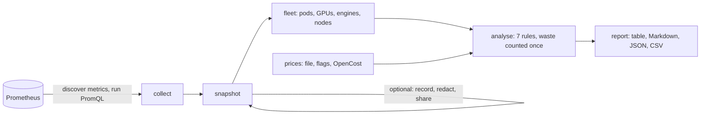

# k8s-gpu-cost-scanner

Find the GPUs a Kubernetes inference cluster pays for and does not use, and what each model costs per hour and per
million tokens.

`gpucost` reads the metrics your cluster already exports from Prometheus: kube-state-metrics for which pods held
GPUs, NVIDIA's DCGM exporter for how busy each GPU was, vLLM or SGLang for what each model server did, and OpenCost
for prices if you run it. It never talks to the Kubernetes API and changes nothing. Every finding comes with its
evidence, the GPU-hours and money it wastes, and the fix.

```text
$ gpucost scan --prometheus http://localhost:9090 --prices prices.csv

GPU fleet
  3 nodes · 9 GPU pods · 481.7 GPU-hours offered · 421.6 requested (87.5%)
  GPU activity 37.2%, over the 100.0% of requested GPU-hours DCGM measured
  Cost $1,368.43 for requested GPUs · $1,608.77 for every allocatable GPU (100.0% of GPU-hours priced)
  Recoverable waste $750.64 · 221.4 GPU-hours · 7 findings (4 high, 1 medium, 1 low, 1 info)

Findings
  HIGH   GPU005 More replicas than the peak load needed · ml/Deployment/llama-70b · 96.3 GPU-hours · $385.33
         - ran up to 3 replicas of meta-llama/Llama-3.3-70B-Instruct
         - the KV cache in use across all replicas peaked at 105.0% of one replica's cache
         - at most 2 replicas were needed to keep each under 80.0% KV use, at the busiest step
         - no request waited in a queue at any replica
         → Cap the workload at 2 replicas, or let an autoscaler follow the load: scale on KV cache
           use or requests in the system, which track an LLM server's capacity, not on CPU. Keep a
           replica of headroom if the peak in this window was not the busiest you expect.
  HIGH   GPU004 GPUs no pod requested · node/gpu-h100-b · 60.1 GPU-hours · $240.33
  HIGH   GPU002 Model served no traffic · ml/Deployment/legacy-mistral · 24.1 GPU-hours · $16.86
  HIGH   GPU001 GPUs held but never used · research/Pod/notebook-ana · 24.1 GPU-hours · $96.33
  MEDIUM GPU003 Engine asleep while holding GPUs · rl/Deployment/policy-server · 16.8 GPU-hours · $11.78
  LOW    GPU006 Serving pod busy for a small share of its time · ml/Deployment/qwen-7b · 21.0 idle GPU-hours

Models
  MODEL                               WORKLOAD                      REPLICAS     GPU-HOURS  COST       ACTIVITY  BUSY    OUTPUT TOKENS  PER 1M TOKENS
  meta-llama/Llama-3.3-70B-Instruct   ml/Deployment/llama-70b       3.0 (max 3)  289.0      $1,156.00  47.4%     100.0%  36.3M          $31.87
  rl/policy-8b                        rl/Deployment/policy-server   1.0 (max 1)  24.1       $16.86     15.1%     30.1%   1.9M           $8.67
  Qwen/Qwen2.5-7B-Instruct            ml/Deployment/qwen-7b         1.0 (max 1)  24.1       $16.86     7.7%      12.8%   236.4K         $71.30
```

That report is the [synthetic demo fleet](internal/synth/scenario.go), trimmed: three GPU nodes, seven workloads
built to have one problem each, at illustrative prices of $4.00 per H100-hour and $0.70 per L4-hour. CI backfills
it into a real Prometheus and scans it on every push; the full output in every format is in
[testdata/golden](testdata/golden).

## What it finds

| Rule | Finding | Counted as waste |
|---|---|---|
| GPU001 | **GPUs held but never used**: activity under 5% at the 95th percentile for the pod's whole time | all its GPU-hours |
| GPU002 | **Model served no traffic**: no request finished, no token generated | all its GPU-hours |
| GPU003 | **Engine asleep while holding GPUs**: vLLM sleep mode frees memory, not the GPU | the time asleep |
| GPU004 | **GPUs no pod requested**: allocatable on a node, requested by nothing | the unrequested GPU-hours |
| GPU005 | **More replicas than the peak load needed**: sized on KV cache use, never when requests queued | replicas beyond the peak need |
| GPU006 | **Serving pod busy for a small share of its time** | no: idle GPU-hours, reported apart |
| GPU007 | **Work much smaller than the GPU**: a MIG slice or smaller GPU may do | no: advice |

Each GPU-hour is counted as waste once: rules run from the most specific cause to the most general, and hours one
rule counts are not counted again. `gpucost explain RULE` and the [findings reference](docs/findings.md) say how
each is found and fixed.

It also reports cost per model and per million output tokens at the utilization actually seen, cost and waste per
workload and per namespace, and its **blind spots**: GPU time it had no activity data or price for, and anything
it could not collect. A blind spot can only hide waste; gpucost never counts a GPU-hour as waste on a guess.

## Quick start

```bash
go install github.com/sunilmehta-si/k8s-gpu-cost-scanner/cmd/gpucost@latest

gpucost doctor --prometheus http://localhost:9090        # what the cluster exports, and what to fix
gpucost scan   --prometheus http://localhost:9090 --price h100-80gb=4.10 --price l4=0.71
gpucost scan   --prometheus http://localhost:9090 --prices prices.csv -o markdown --out report.md
```

Release archives for Linux, macOS and Windows (amd64 and arm64) and a container image are built by the release
workflow, with provenance you can check with `gh attestation verify`. [Running gpucost](docs/running.md) covers
Thanos, Mimir, Grafana Cloud and managed Prometheus, an in-cluster CronJob, a scheduled CI job with a budget gate,
and recording a window to analyse offline or share redacted.

## What it needs

| Source | For | Without it |
|---|---|---|
| kube-state-metrics | which pods held GPUs, on which node, for which workload | nothing to analyse |
| DCGM exporter, with pod mapping | how busy each GPU was | no idle GPU can be found |
| vLLM or SGLang `/metrics`, scraped by a PodMonitor | traffic, KV cache, tokens | no model costs or serving rules |
| OpenCost (optional) | GPU prices per node | give prices with `--prices` or `--price` |

The DCGM exporter renamed its fields and changed their units in 4.9.0; gpucost reads both naming schemes and converts
the old units, so reports read the same across the upgrade. It also handles the exporter's pod labels arriving as
`exported_pod`, MIG slices, vLLM's data-parallel engines and SGLang's tensor-parallel ranks. The
[metrics reference](docs/metrics.md) lists every query.

## Prices

gpucost ships no price list: list prices differ by cloud, region, commitment and contract, and a made-up number would
make every dollar wrong. Prices come from you, by GPU model in any spelling, family, instance type or a default, or
from OpenCost; an unpriced node is reported in GPU-hours. See [pricing](docs/pricing.md).

## How it works



A scan first collects a snapshot of one window's raw metrics, then analyses it. Keeping the two apart means a window
can be recorded once and analysed again with other prices or thresholds, offline, and that every test of the
analysis runs on a fixed input. The [methodology](docs/methodology.md) explains each number and the limits.

## Trust

- **Read-only.** Only the Prometheus query and label APIs are called. The in-cluster CronJob mounts no service
  account token and has no RBAC.
- **No dependencies.** The binary is the Go standard library and this repository; there is nothing else to audit.
- **Tested against a real Prometheus.** A synthetic fleet is backfilled into Prometheus 3.15.1 and scanned in CI, and
  each finding is checked against the answer the fleet was built to have. Unit tests cover every rule, golden files
  every output format, fuzz tests the parsers, and a benchmark a 1,600-GPU day (0.16 s on an Apple M5 Pro: `go test -bench ScanLargeFleet ./internal/analyze`).
- **Pinned.** Every GitHub Action is pinned by commit and every pin waits 14 days after its release, except
  security fixes; the release attests the provenance of its binaries and image.

## Project

- [CHANGELOG](CHANGELOG.md), [contributing](CONTRIBUTING.md), [security policy](SECURITY.md).
- Related: [k8s-gpu-scheduler-benchmark](https://github.com/sunilmehta-si/k8s-gpu-scheduler-benchmark) measures
  which scheduler wastes fewest GPUs; [k8s-inference-autoscaling-benchmark](https://github.com/sunilmehta-si/k8s-inference-autoscaling-benchmark)
  which autoscaling signal holds a latency objective for the fewest replicas.

## License

Apache 2.0. See [LICENSE](LICENSE).
